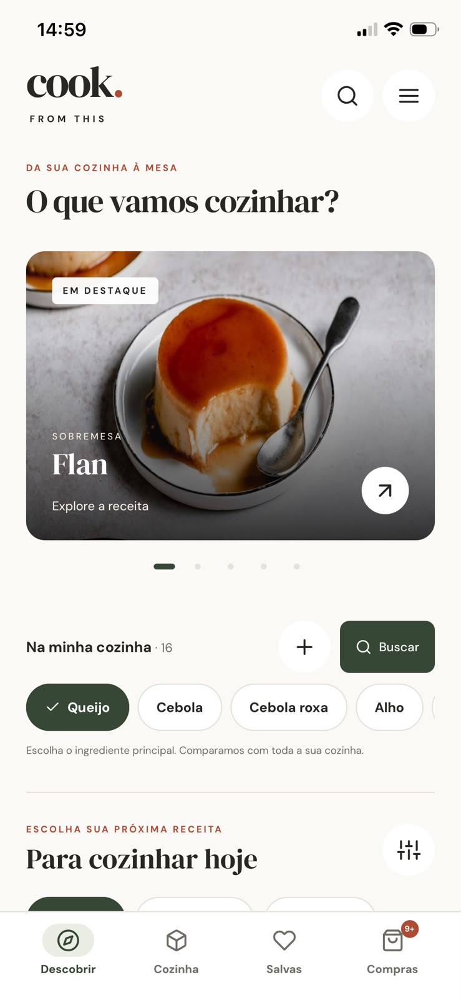
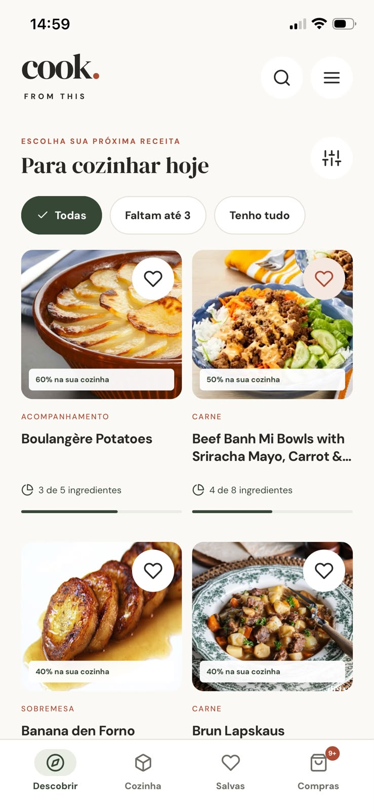
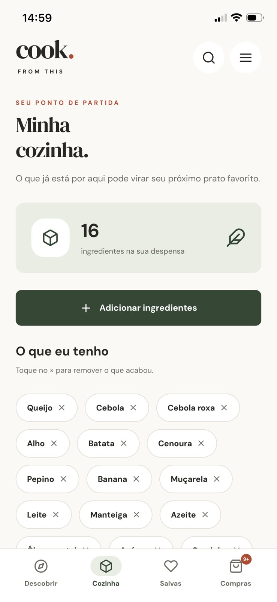
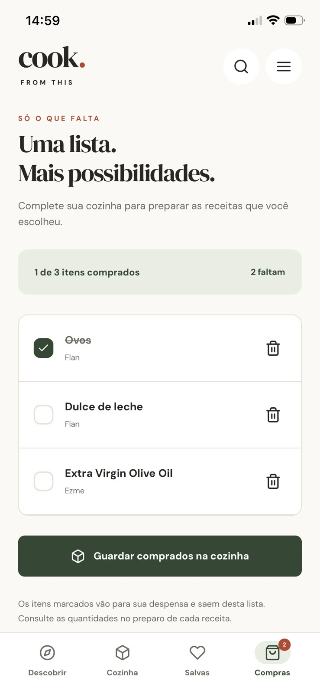
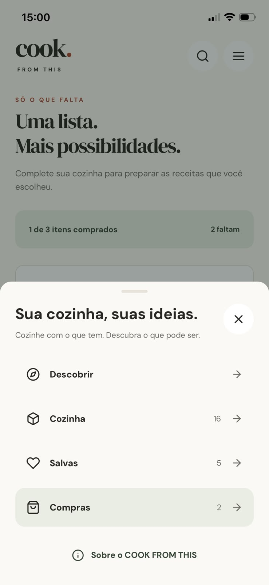
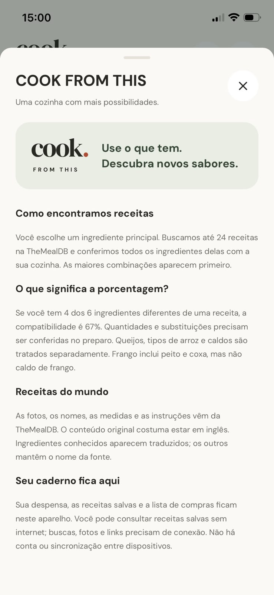

# COOK FROM THIS

**Use o que tem. Descubra novos sabores.**

Aplicativo de receitas para iOS e Android que transforma os ingredientes da sua cozinha em sugestões para a próxima refeição. Escolha um ingrediente principal, descubra o que consegue preparar e leve os ingredientes que faltam para uma lista de compras.

Desenvolvido com **React Native, TypeScript e Expo**, com receitas da **TheMealDB** e dados pessoais armazenados no próprio dispositivo.

## O aplicativo

Capturas do aplicativo em um iPhone. Fotografias das receitas fornecidas pela TheMealDB.

<table>
  <tr>
    <th>Descobrir</th>
    <th>Receitas e compatibilidade</th>
    <th>Minha cozinha</th>
  </tr>
  <tr>
    <td align="center" width="33%"></td>
    <td align="center" width="33%"></td>
    <td align="center" width="33%"></td>
  </tr>
  <tr>
    <th>Lista de compras</th>
    <th>Navegação</th>
    <th>Sobre o aplicativo</th>
  </tr>
  <tr>
    <td align="center"></td>
    <td align="center"></td>
    <td align="center"></td>
  </tr>
</table>

## Funcionalidades

| Área                | O que você pode fazer                                                                                                                           |
| ------------------- | ----------------------------------------------------------------------------------------------------------------------------------------------- |
| **Descobrir**       | Explorar o carrossel de destaques, buscar pelo nome original ou por um ingrediente principal e filtrar por categoria ou ingredientes faltantes. |
| **Minha cozinha**   | Adicionar e remover ingredientes da despensa usando um catálogo com nomes em português.                                                         |
| **Receitas**        | Consultar ingredientes, medidas, preparo, origem e sugestões relacionadas ao final de cada receita.                                             |
| **Compatibilidade** | Ver o percentual de ingredientes disponíveis e identificar exatamente o que falta.                                                              |
| **Salvas**          | Guardar receitas completas no aparelho e consultar o conteúdo salvo sem conexão.                                                                |
| **Compras**         | Reunir ingredientes faltantes sem duplicatas, marcar o que foi comprado e transferir esses itens para a despensa.                               |

A home mostra **até seis cards por vez**. O botão **Ver mais** substitui os cards pelo próximo grupo, mantendo a tela compacta. A descoberta continua além da seleção inicial; o total disponível depende das respostas da API.

O carrossel permite deslizar e navegar pelos indicadores centrais. A alternância automática respeita a preferência de reduzir movimento e leitores de tela. As telas também tratam carregamento, resultados vazios, falhas de conexão e nova tentativa.

## Tecnologias

| Tecnologia                      | Uso no projeto                                                          |
| ------------------------------- | ----------------------------------------------------------------------- |
| **React Native 0.86**           | Interface nativa para iOS e Android.                                    |
| **React 19.2**                  | Componentes, estado, hooks e contexto.                                  |
| **TypeScript 6**                | Tipagem dos modelos, contratos e propriedades dos componentes.          |
| **Expo SDK 57**                 | Desenvolvimento, execução no Expo Go e configuração dos builds nativos. |
| **AsyncStorage**                | Persistência local da despensa, receitas salvas e lista de compras.     |
| **Expo Font e Linear Gradient** | Fontes locais DM Sans / DM Serif Display e apresentação dos destaques.  |
| **Jest, ESLint e Prettier**     | Testes, análise estática e formatação do código.                        |

As versões completas das dependências estão em [package.json](package.json).

## API: TheMealDB

O aplicativo utiliza a [TheMealDB](https://www.themealdb.com/api.php), uma API REST que retorna receitas em JSON. Nomes, fotografias, categorias, ingredientes, medidas e instruções vêm dessa fonte.

A integração está em [TheMealDbRepository.ts](src/features/recipes/data/TheMealDbRepository.ts). O [mealDbMapper.ts](src/features/recipes/data/mealDbMapper.ts) converte a resposta da API para os modelos utilizados pelo aplicativo.

**URL base de desenvolvimento:**

```text
https://www.themealdb.com/api/json/v1/1/
```

| Endpoint utilizado     | Finalidade                                                        |
| ---------------------- | ----------------------------------------------------------------- |
| `search.php?s=`        | Obter a seleção inicial de receitas.                              |
| `search.php?s=chicken` | Buscar receitas pelo nome.                                        |
| `search.php?f=a`       | Continuar a descoberta pela primeira letra do nome.               |
| `filter.php?i=Chicken` | Buscar receitas com o ingrediente principal escolhido.            |
| `lookup.php?i=52772`   | Carregar os detalhes completos de uma receita.                    |
| `filter.php?c=Chicken` | Buscar candidatos da mesma categoria para sugestões relacionadas. |

Os parâmetros acima são exemplos. O app envia o nome, ingrediente, letra, categoria ou identificador correspondente à ação da pessoa.

O filtro gratuito aceita **um ingrediente por consulta**. Depois, o aplicativo compara cada receita com **toda a despensa**, localmente. Isso permite mostrar compatibilidade sem um backend próprio; o filtro global por múltiplos ingredientes da API é um recurso premium.

A chave pública de teste **`1`** é destinada a desenvolvimento e uso educacional. Antes de publicar nas lojas, consulte os requisitos de apoio e os termos do provedor na [documentação da TheMealDB](https://www.themealdb.com/api.php).

### Como calculamos a compatibilidade

```text
Compatibilidade = ingredientes disponíveis ÷ ingredientes diferentes da receita × 100
```

Se uma receita pede **frango, arroz, tomate, queijo, alho e cebola**, e a despensa contém os quatro primeiros, o resultado é **4 de 6 ingredientes: 67%**. Alho e cebola aparecem como faltantes.

A regra usa identificadores normalizados e equivalências explícitas entre nomes em português e inglês. Campos vazios são ignorados e ingredientes repetidos contam uma vez no percentual. Quantidades e possíveis substituições devem ser conferidas no preparo; o percentual compara tipos de ingredientes.

Na busca por ingrediente, o app carrega detalhes em lotes de **12 receitas**, com até **4 consultas simultâneas** e cache em memória. Esse lote não limita o total da busca. A ordem de compatibilidade considera o grupo já carregado, sem exigir o download de todo o catálogo.

## Estrutura e arquitetura

O código é organizado por funcionalidade, com separação entre regras de domínio, acesso a dados e apresentação.

```text
App.tsx                         # Montagem do aplicativo e injeção dos serviços
src/
├── app/                        # Navegação, cabeçalho, abas, menu e painel Sobre
├── features/
│   ├── recipes/
│   │   ├── domain/             # Modelos, contratos, compatibilidade e recomendações
│   │   ├── data/               # Integração TheMealDB e conversão das respostas
│   │   ├── hooks/              # Busca, relacionadas, cancelamento e erros
│   │   ├── components/         # Carrossel, cards, grade e paginação
│   │   └── screens/            # Descobrir, detalhes e receitas salvas
│   └── kitchen/
│       ├── domain/             # Modelos e contrato de armazenamento
│       ├── data/               # Persistência com AsyncStorage
│       ├── context/            # Estado compartilhado da cozinha
│       ├── components/         # Seletor de ingredientes
│       └── screens/            # Despensa e compras
└── shared/
    ├── components/             # Botões, ícones, campos, painéis e outros básicos
    ├── hooks/                  # Preferências compartilhadas
    └── theme/                  # Cores, fontes e medidas
__tests__/                      # Testes de regras, serviços e fluxos
assets/                         # Recursos visuais da marca e do splash
scripts/                        # Utilitários de build e geração de assets
docs/                           # Guia de desenvolvimento e capturas de tela
```

| Camada           | Responsabilidade                                                             |
| ---------------- | ---------------------------------------------------------------------------- |
| **Domínio**      | Regras e contratos independentes de React Native, rede e armazenamento.      |
| **Dados**        | Implementações concretas da API e do armazenamento local.                    |
| **Apresentação** | Telas, componentes, hooks e contexto que exibem informações e recebem ações. |
| **Montagem**     | Conexão das implementações aos contratos em `App.tsx`.                       |

Essa separação permite testar as regras sem abrir uma tela e trocar a fonte de receitas sem reescrever o cálculo de compatibilidade. A navegação atual usa estado React e histórico de receitas, com tratamento do botão voltar no Android.

Um componente básico, como `Button`, pertence a `shared`. Um componente que conhece uma receita, como `RecipeCard`, pertence a `features/recipes`. O cabeçalho específico deste aplicativo, `AppHeader`, pertence a `app`.

## Como executar

### Pré-requisitos

- **Node.js 22.11 ou superior** e npm.
- **Expo Go compatível com o SDK 57** no iPhone ou Android.
- Computador e celular conectados à mesma rede Wi-Fi.

Android Studio e Xcode não são necessários para executar em um aparelho físico com Expo Go.

### Instalação e início

Na pasta do projeto, execute:

```bash
npm install
npx expo start
```

No **iPhone**, entre na mesma conta Expo no Expo Go e no terminal, usando `npx expo login`, e escaneie o QR Code com a câmera. No **Android**, abra o Expo Go e use a opção de escanear o QR Code. Confira também a [orientação oficial para iniciar um projeto Expo](https://docs.expo.dev/get-started/start-developing/).

O comando padrão usa a rede local. Caso a rede impeça a conexão entre os aparelhos, `npm run start:tunnel` é uma alternativa opcional.

### Configuração da API

O projeto já utiliza a chave de desenvolvimento `1`: **não é preciso criar um `.env` para começar**. Para configurar outra chave, crie um `.env` a partir de [.env.example](.env.example):

```dotenv
EXPO_PUBLIC_MEALDB_API_KEY=1
```

Variáveis com o prefixo `EXPO_PUBLIC_` ficam acessíveis no aplicativo distribuído; use esse campo apenas para uma chave que possa ser pública. Reinicie o Expo depois de alterar a configuração.

### Comandos disponíveis

| Comando                         | Finalidade                                                   |
| ------------------------------- | ------------------------------------------------------------ |
| `npm start`                     | Iniciar o servidor de desenvolvimento para Expo Go.          |
| `npm run web`                   | Executar a prévia no navegador.                              |
| `npm run typecheck`             | Verificar os tipos TypeScript.                               |
| `npm run lint`                  | Verificar o código com ESLint.                               |
| `npm run format`                | Formatar os arquivos de código com Prettier.                 |
| `npm test -- --runInBand`       | Executar a suíte de testes.                                  |
| `npm run doctor`                | Verificar a configuração e compatibilidade com Expo.         |
| `npm run build:android:preview` | Gerar um APK local para testes; exige Java 17 e Android SDK. |

O splash personalizado deve ser conferido em um aplicativo compilado. A abertura do Expo Go pertence ao próprio Expo Go. Instruções de build e um roteiro para estudar o código estão no [guia de desenvolvimento](docs/GUIA_DE_DESENVOLVIMENTO.md).

## Qualidade e limites atuais

Os testes cobrem o cálculo de compatibilidade, equivalências de ingredientes, conversão dos dados, cache, paginação, tratamento de erros, persistência e o fluxo despensa → receita → salvas → compras. Também há verificações de carrossel, sugestões relacionadas e histórico de navegação.

- **Dados locais:** despensa, salvas e compras ficam no aparelho, sem conta de usuário no app ou sincronização entre dispositivos. Desinstalar o aplicativo pode apagar esses dados.
- **Conexão:** o conteúdo de receitas salvas pode ser lido offline; novas buscas, fotografias remotas e links precisam de internet.
- **Idioma:** nomes e preparo permanecem no idioma da fonte, geralmente inglês. Categorias e ingredientes conhecidos são apresentados em português.
- **Catálogo:** a quantidade de receitas depende dos endpoints disponíveis na TheMealDB.
- **Informações nutricionais:** o app não estima calorias, porções ou tempo de preparo ausentes na fonte.

## Autoria

Desenvolvido por **Giselly**.
